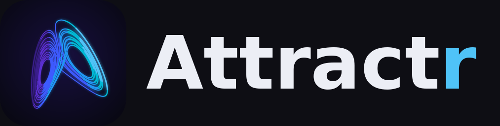
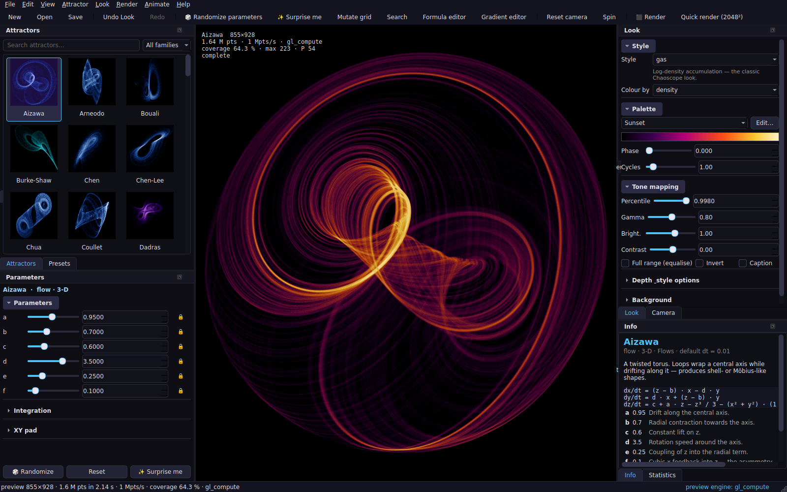

<p align="center"></p>

# Attractr

**Attractr** is a desktop strange-attractor studio: explore chaotic systems with live
GPU previews, tweak parameters with sliders and an XY pad, write your own formulas in a
code editor, design colour gradients, key-frame animations and render print-quality
images with full statistical reports.

* Python 3.11+ · PySide6 · NumPy · numba · ModernGL · pyopencl
* Two GPU engines (fast preview, precise final) + a multi-threaded CPU reference engine
* 50+ built-in attractors written in a tiny formula language — add your own without Python
* Render reports in Markdown / Text / HTML / PDF next to every full-size render
* Headless CLI: `attractr render`, `attractr animate`, `attractr list`, `attractr info`



Documentation lives in [`docs/`](docs/README.md) — start with the
[GUI guide](docs/gui_guide.md) or the [master plan](docs/PLAN.md). Every built-in
attractor at its defaults: [`docs/images/contact_sheet.png`](docs/images/contact_sheet.png).

## Install (development)

```bash
pip install -e ".[dev]"
attractr                                  # GUI
attractr render lorenz --size 2048x2048 --report md   # CLI
attractr --help
pytest                                    # tests (offscreen Qt)
```

Requirements: Python 3.11+, a GPU/driver with OpenGL 4.3 for the compute engines (or
OpenCL for the `opencl` engine); everything also runs on the CPU engine alone. `ffmpeg`
on `PATH` enables video encoding. On first launch Attractr pre-compiles its CPU kernels in
a background process (≈ 1–3 minutes once); thumbnails and probes run in a helper process so
the interface never stalls.

## Acknowledgements & attributions

Attractr re-implements, corrects and extends ideas from three open-source projects whose
sources are kept in `sample_source/` for reference:

* **Chaoscope** (Android/iOS/C++ re-imagining) by Lucas Balancin — Apache-2.0.
  Attractor parameter metadata, render styles, curated presets, interaction model and the
  GPU compute-histogram design.
* **chaoscope** (pure-C renderer + Win32 GUI) by Shpati Koleka — 42 flow systems with
  references, RK4, splat kernels, percentile normalisation, colour-by modes, framing.
* **strange-attractors-webgl** by Jérémie Piellard — progressive accumulation,
  density-per-pixel budgeting, duotone compositing, Bedhead & Fractal Dream.

All three are tributes to **Nicolas Desprez's original Chaoscope** (2000s, Windows), whose
render modes (Gas, Light, Liquid, Plasma, Solid) and Search feature Attractr also
re-creates. No code or assets from the original Chaoscope are used.

Attractr itself is released under the [MIT licence](LICENSE).
