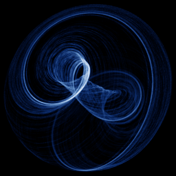

# Aizawa

`aizawa` · flow · 3-D · family: Flows



A twisted torus. Loops wrap a central axis while drifting along it — produces shell- or Möbius-like shapes.

## Equations

```text
dx/dt = (z − b) · x − d · y
dy/dt = d · x + (z − b) · y
dz/dt = c + a · z − z³ / 3 − (x² + y²) · (1 + e · z) + f · z · x³
```

## Parameters

| Name | Default | Range | Meaning |
|---|---|---|---|
| a | 0.95 | [0, 2] | Drift along the central axis. |
| b | 0.7 | [0, 2] | Radial contraction towards the axis. |
| c | 0.6 | [0, 2] | Constant lift on z. |
| d | 3.5 | [0, 5] | Rotation speed around the axis. |
| e | 0.25 | [0, 1] | Coupling of z into the radial term. |
| f | 0.1 | [0, 1] | Cubic x feedback into z — the asymmetry. |

Integration: RK4, default dt = 0.01, initial condition (0.1, 0.1, 0.1).

## References

- Aizawa system — ChaoticDynamicalSystemLibrary (Julia) docs

## Source (`.atr`)

```text
name: Aizawa
family: Flows
desc: A twisted torus. Loops wrap a central axis while drifting along it — produces shell- or Möbius-like shapes.
ref: Aizawa system — ChaoticDynamicalSystemLibrary (Julia) docs
tags: flow, 3d
dt: 0.01
ic: 0.1 0.1 0.1
camera: 30 25 0 1

param a = 0.95 [0, 2] "Drift along the central axis."
param b = 0.7 [0, 2] "Radial contraction towards the axis."
param c = 0.6 [0, 2] "Constant lift on z."
param d = 3.5 [0, 5] "Rotation speed around the axis."
param e = 0.25 [0, 1] "Coupling of z into the radial term."
param f = 0.1 [0, 1] "Cubic x feedback into z — the asymmetry."

dx = (z - b)*x - d*y
dy = d*x + (z - b)*y
dz = c + a*z - z^3/3 - (x^2 + y^2)*(1 + e*z) + f*z*x^3
```

Render it: `attractr render aizawa --size 2048x2048 --report md`
