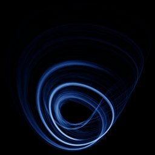

# Anishchenko–Astakhov

`anishchenko_astakhov` · flow · 3-D · family: Flows



A model of a generator with inertial nonlinearity (a vacuum-tube oscillator). The z equation switches on only for positive x, giving the attractor a sharp, half-folded profile.

## Equations

```text
dx/dt = m · x + y − x · z
dy/dt = −x
dz/dt = −g · z + g · step(0, x) · x²
```

## Parameters

| Name | Default | Range | Meaning |
|---|---|---|---|
| m | 1.2 | [0.5, 2] | m — excitation of the oscillator. |
| g | 0.5 | [0.1, 1] | g — inertia of the nonlinear feedback. |

Integration: RK4, default dt = 0.02, initial condition (0.1, 0.1, 0.1, 0.0).

## References

- V. S. Anishchenko, "Dynamical Chaos — Models and Experiments" (1995)

## Source (`.atr`)

```text
name: Anishchenko–Astakhov
family: Flows
desc: A model of a generator with inertial nonlinearity (a vacuum-tube oscillator). The z equation switches on only for positive x, giving the attractor a sharp, half-folded profile.
ref: V. S. Anishchenko, "Dynamical Chaos — Models and Experiments" (1995)
tags: flow, 3d
dt: 0.02
ic: 0.1 0.1 0.1
camera: 25 20 0 1

param m = 1.2 [0.5, 2] "m — excitation of the oscillator."
param g = 0.5 [0.1, 1] "g — inertia of the nonlinear feedback."

dx = m*x + y - x*z
dy = -x
dz = -g*z + g*step(0, x)*x^2
```

Render it: `attractr render anishchenko_astakhov --size 2048x2048 --report md`
