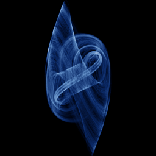

# Arneodo

`arneodo` · flow · 3-D · family: Flows



Arneodo–Coullet–Tresser jerk system — a cubic jerk equation folding a single scroll.

## Equations

```text
dx/dt = y
dy/dt = z
dz/dt = −a · x − b · y − c · z + d · x³
```

## Parameters

| Name | Default | Range | Meaning |
|---|---|---|---|
| a | -5.5 | [-8, -3] |  |
| b | 3.5 | [2, 5] |  |
| c | 1 | [0.5, 2] |  |
| d | -1 | [-2, 0] |  |

Integration: RK4, default dt = 0.02, initial condition (0.1, 0.1, 0.1, 0.0).

## References

- A. Arneodo, P. Coullet & C. Tresser (1981)

## Source (`.atr`)

```text
name: Arneodo
family: Flows
desc: Arneodo–Coullet–Tresser jerk system — a cubic jerk equation folding a single scroll.
ref: A. Arneodo, P. Coullet & C. Tresser (1981)
tags: flow, 3d
dt: 0.02
ic: 0.1 0.1 0.1
camera: 25 20 0 1

param a = -5.5 [-8, -3]
param b = 3.5 [2, 5]
param c = 1.0 [0.5, 2]
param d = -1.0 [-2, 0]

dx = y
dy = z
dz = -a*x - b*y - c*z + d*x^3
```

Render it: `attractr render arneodo --size 2048x2048 --report md`
