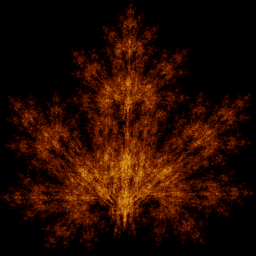

# Maple leaf

`barnsley_leaf` · ifs · 2-D · family: IFS



Michael Barnsley's four-map maple leaf — the fern's broad-leaved sibling, built from the same affine "collage" idea.

## Equations

```text
with p = 0.1:
    x′ = 0.14 · x + 0.01 · y − 0.08
    y′ = 0.51 · y − 1.31
with p = 0.35:
    x′ = spread · (0.43 · x + 0.52 · y + 1.49)
    y′ = −0.45 · x + 0.5 · y − 0.75
with p = 0.35:
    x′ = spread · (0.45 · x − 0.49 · y − 1.62)
    y′ = 0.47 · x + 0.47 · y − 0.74
with p = 0.2:
    x′ = 0.49 · x + 0.02
    y′ = 0.51 · y + 1.62
```

## Parameters

| Name | Default | Range | Meaning |
|---|---|---|---|
| spread | 1 | [0.7, 1.3] | Scales the sideways lobes. |

## References

- M. F. Barnsley, "Fractals Everywhere" (1988); coefficients via P. Bourke

## Source (`.atr`)

```text
name: Maple leaf
family: IFS
desc: Michael Barnsley's four-map maple leaf — the fern's broad-leaved sibling, built from the same affine "collage" idea.
ref: M. F. Barnsley, "Fractals Everywhere" (1988); coefficients via P. Bourke
tags: ifs, 2d, classic
dims: 2
warmup: 20
ic: 0 0 0
palette: fire

param spread = 1 [0.7, 1.3] "Scales the sideways lobes."

choose {
  0.10: x' = 0.14*x + 0.01*y - 0.08;                      y' = 0.51*y - 1.31
  0.35: x' = spread*(0.43*x + 0.52*y + 1.49);             y' = -0.45*x + 0.50*y - 0.75
  0.35: x' = spread*(0.45*x - 0.49*y - 1.62);             y' = 0.47*x + 0.47*y - 0.74
  0.20: x' = 0.49*x + 0.02;                               y' = 0.51*y + 1.62
}
```

Render it: `attractr render barnsley_leaf --size 2048x2048 --report md`
