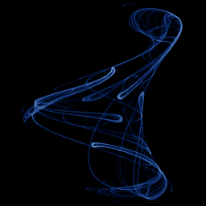

# Bedhead

`bedhead` · map · 2-D · family: Maps



Ivan Emrich's "Bedhead" map — tangled, hair-like strands that fold over each other.

## Equations

```text
x′ = sin(x · y / b) + cos(a · x − y)
y′ = x + sin(y) / b
```

## Parameters

| Name | Default | Range | Meaning |
|---|---|---|---|
| a | -0.81 | [-1, 1] | Cosine phase coupling between x and y. |
| b | -0.92 | [-1, 1] | Divisor of the x·y and sin(y) terms — small |b| makes the strands wilder. |

## References

- https://www.algosome.com/articles/strange-attractors-bedhead.html

## Source (`.atr`)

```text
name: Bedhead
family: Maps
desc: Ivan Emrich's "Bedhead" map — tangled, hair-like strands that fold over each other.
ref: https://www.algosome.com/articles/strange-attractors-bedhead.html
tags: map, 2d
dims: 2
warmup: 100
ic: 1 1 0

param a = -0.81 [-1, 1] "Cosine phase coupling between x and y."
param b = -0.92 [-1, 1] "Divisor of the x·y and sin(y) terms — small |b| makes the strands wilder."

x' = sin(x*y/b) + cos(a*x - y)
y' = x + sin(y)/b
```

Render it: `attractr render bedhead --size 2048x2048 --report md`
