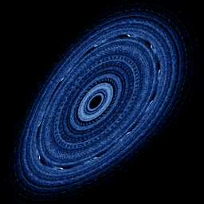

# Bogdanov

`bogdanov` · map · 2-D · family: Maps



A discrete version of the Bogdanov–Takens normal form — nested islands and a chaotic sea.

## Equations

```text
yn = y + ε · y + k · x · (x − 1) + μ · x · y
x′ = x + yn
y′ = yn
```

## Parameters

| Name | Default | Range | Meaning |
|---|---|---|---|
| eps | 0 | [-0.1, 0.1] |  |
| k | 1.2 | [0.5, 2] |  |
| mu | 0 | [-0.5, 0.5] |  |

## References

- D. K. Arrowsmith et al., Int. J. Bifurcation Chaos 3 (1993)

## Source (`.atr`)

```text
name: Bogdanov
family: Maps
desc: A discrete version of the Bogdanov–Takens normal form — nested islands and a chaotic sea.
ref: D. K. Arrowsmith et al., Int. J. Bifurcation Chaos 3 (1993)
tags: map, 2d
dims: 2
ic: 0.1 0.1 0
jitter: 0.3
warmup: 50

param eps = 0.0 [-0.1, 0.1]
param k = 1.2 [0.5, 2]
param mu = 0.0 [-0.5, 0.5]

yn = y + eps*y + k*x*(x - 1) + mu*x*y
x' = x + yn
y' = yn
```

Render it: `attractr render bogdanov --size 2048x2048 --report md`
