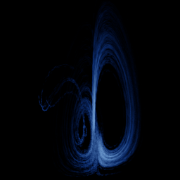

# Bouali

`bouali` · flow · 3-D · family: Flows



Bouali's system — a double-wing attractor from an economic model.

## Equations

```text
dx/dt = x · (4 − y) + a · z
dy/dt = −y · (1 − x²)
dz/dt = −x · (1.5 − s · z) − 0.05 · z
```

## Parameters

| Name | Default | Range | Meaning |
|---|---|---|---|
| a | 0.3 | [0.1, 0.6] |  |
| s | 1 | [0.5, 1.5] |  |

Integration: RK4, default dt = 0.005, initial condition (1.0, 0.1, 0.1).

## References

- S. Bouali, Int. J. Bifurcation Chaos (2012)

## Source (`.atr`)

```text
name: Bouali
family: Flows
desc: Bouali's system — a double-wing attractor from an economic model.
ref: S. Bouali, Int. J. Bifurcation Chaos (2012)
tags: flow, 3d
dt: 0.005
ic: 1 0.1 0.1
camera: 25 20 0 1

param a = 0.3 [0.1, 0.6]
param s = 1.0 [0.5, 1.5]

dx = x*(4 - y) + a*z
dy = -y*(1 - x^2)
dz = -x*(1.5 - s*z) - 0.05*z
```

Render it: `attractr render bouali --size 2048x2048 --report md`
