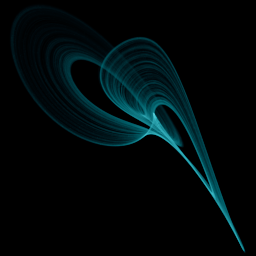

# Burke-Shaw

`burke_shaw` · flow · 3-D · family: Flows



A fast double-spiral that winds into a tight tornado of nested shells — dense, galaxy-like swirls.

## Equations

```text
dx/dt = −s · (x + y)
dy/dt = −y − s · x · z
dz/dt = s · x · y + v
```

## Parameters

| Name | Default | Range | Meaning |
|---|---|---|---|
| s | 10 | [5, 15] | Coupling strength — drives the swirl rate. Higher winds the spiral tighter. |
| v | 4.272 | [2, 7] | Lift — constant push on z. |

Integration: RK4, default dt = 0.005, initial condition (0.6, 0.5, 0.5, 0.0).

## References

- B. Burke & R. Shaw (1981); parameters after P. Bourke

## Source (`.atr`)

```text
name: Burke-Shaw
family: Flows
desc: A fast double-spiral that winds into a tight tornado of nested shells — dense, galaxy-like swirls.
ref: B. Burke & R. Shaw (1981); parameters after P. Bourke
tags: flow, 3d
dt: 0.005
ic: 0.6 0.5 0.5
camera: 25 25 0 1
palette: electric
param s = 10.0 [5, 15] "Coupling strength — drives the swirl rate. Higher winds the spiral tighter."
param v = 4.272 [2, 7] "Lift — constant push on z."

dx = -s*(x + y)
dy = -y - s*x*z
dz = s*x*y + v
```

Render it: `attractr render burke_shaw --size 2048x2048 --report md`
