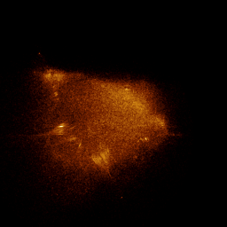

# Burning Ship (escape orbits)

`burning_ship_brot` · escape · 2-D · family: Escape



The Buddhabrot technique applied to the Burning Ship iteration z → (|Re z| + i|Im z|)² + c: every escaping orbit's path is accumulated, so the ship's hull and masts appear as the ghostly trails of the points that left. Colour by w (escape count) for the flames.

## Equations

```text
ax = abs(x)
ay = abs(y)
x′ = ax · ax − ay · ay + x0
y′ = 2 · ax · ay + y0
color = w
```

## References

- M. Michelitsch & O. E. Rössler, "The Burning Ship and its quasi-Julia sets", Computers & Graphics 16 (1992)

## Source (`.atr`)

```text
name: Burning Ship (escape orbits)
family: Escape
desc: The Buddhabrot technique applied to the Burning Ship iteration z → (|Re z| + i|Im z|)² + c: every escaping orbit's path is accumulated, so the ship's hull and masts appear as the ghostly trails of the points that left. Colour by w (escape count) for the flames.
ref: M. Michelitsch & O. E. Rössler, "The Burning Ship and its quasi-Julia sets", Computers & Graphics 16 (1992)
tags: escape, fractal, 2d
kind: escape
dims: 2
region: -2.5 1.5 -2.0 1.2
bailout: 2
max_iter: 400
min_iter: 10
boost: 20
camera: 0 0 180 1
palette: fire

ax = abs(x)
ay = abs(y)
x' = ax*ax - ay*ay + x0
y' = 2*ax*ay + y0
color = w
```

Render it: `attractr render burning_ship_brot --size 2048x2048 --report md`
