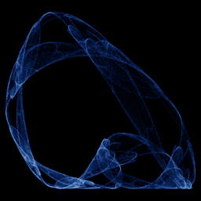

# Cathala

`cathala` · map · 2-D · family: Maps



The minimal quadratic map of J.-C. Cathala — one linear and one squared term, yet it folds into a thin, layered ribbon.

## Equations

```text
x′ = a · x + y
y′ = b + x²
```

## Parameters

| Name | Default | Range | Meaning |
|---|---|---|---|
| a | 0.7 | [-1, 1] | Linear coefficient on x (stretching). |
| b | -0.82 | [-1.5, 0.5] | Offset fed into the square (folding). |

## References

- J.-C. Cathala, Int. J. Bifurcation and Chaos (1990s); popularised by Chaoscope's author

## Source (`.atr`)

```text
name: Cathala
family: Maps
desc: The minimal quadratic map of J.-C. Cathala — one linear and one squared term, yet it folds into a thin, layered ribbon.
ref: J.-C. Cathala, Int. J. Bifurcation and Chaos (1990s); popularised by Chaoscope's author
tags: map, 2d
dims: 2
ic: 0.1 0.1 0
warmup: 200

param a = 0.7 [-1, 1] "Linear coefficient on x (stretching)."
param b = -0.82 [-1.5, 0.5] "Offset fed into the square (folding)."

x' = a*x + y
y' = b + x^2
```

Render it: `attractr render cathala --size 2048x2048 --report md`
