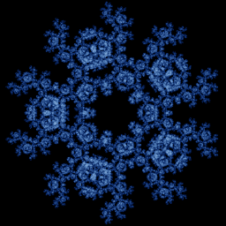

# Chaos game (n-gon with rules)

`chaos_game_ngon` · map · 2-D · family: IFS



The chaos game on a regular n-gon — jump a fraction s towards a random vertex — with the classic *restriction rules*: forbid the previous vertex, or the previous vertex and its neighbour. The rules turn a uniform blob into Sierpinski-like carpets, flowers and spirals. (Uses the 4th state variable w to remember the last vertex.)

## Equations

```text
k0 = floor(rand() · n)
k1 = mod(w + 1 + floor(rand() · (n − 1)), n)
k2 = mod(w + 2 + floor(rand() · (n − 2)), n)
k = select(avoid ≥ 2 and (k0 = w or mod(k0 − w + n, n) = 1), k2, select(avoid ≥ 1 and k0 = w, k1, k0))
ang = 2 · 3.141592654 · k / n + twist · 3.141592654 / 180
vx = cos(ang)
vy = sin(ang)
x′ = x + (vx − x) · s
y′ = y + (vy − y) · s
w′ = k
```

## Parameters

| Name | Default | Range | Meaning |
|---|---|---|---|
| n | 5 | [3, 12] | Number of vertices. |
| s | 0.5 | [0.2, 0.8] | Jump fraction towards the chosen vertex. |
| avoid | 1 | [0, 2] | 0: free, 1: not the previous vertex, 2: not the previous vertex nor its next neighbour. |
| twist | 0 | [-90, 90] | Rotate each jump target by this many degrees (spirals). |

## References

- Wikipedia, "Chaos game — Restricted chaos game"

## Source (`.atr`)

```text
name: Chaos game (n-gon with rules)
family: IFS
desc: The chaos game on a regular n-gon — jump a fraction s towards a random vertex — with the classic *restriction rules*: forbid the previous vertex, or the previous vertex and its neighbour. The rules turn a uniform blob into Sierpinski-like carpets, flowers and spirals. (Uses the 4th state variable w to remember the last vertex.)
ref: Wikipedia, "Chaos game — Restricted chaos game"
tags: ifs, 2d, classic
dims: 2
ic: 0 0 0 0
warmup: 30

param n = 5 [3, 12] int "Number of vertices."
param s = 0.5 [0.2, 0.8] "Jump fraction towards the chosen vertex."
param avoid = 1 [0, 2] int "0: free, 1: not the previous vertex, 2: not the previous vertex nor its next neighbour."
param twist = 0 [-90, 90] "Rotate each jump target by this many degrees (spirals)."

k0   = floor(rand()*n)
k1   = mod(w + 1 + floor(rand()*(n - 1)), n)
k2   = mod(w + 2 + floor(rand()*(n - 2)), n)
k    = select(avoid >= 2 and (k0 == w or mod(k0 - w + n, n) == 1), k2, select(avoid >= 1 and k0 == w, k1, k0))
ang  = 2*pi*k/n + twist*pi/180
vx   = cos(ang)
vy   = sin(ang)
x'   = x + (vx - x)*s
y'   = y + (vy - y)*s
w'   = k
```

Render it: `attractr render chaos_game_ngon --size 2048x2048 --report md`
