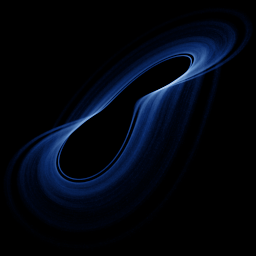

# Chen-Lee

`chen_lee` · flow · 3-D · family: Flows



Derived from the Euler equations of a rigid body — three symmetric, interleaved scrolls.

## Equations

```text
dx/dt = a · x − y · z
dy/dt = b · y + x · z
dz/dt = c · z + x · y / 3
```

## Parameters

| Name | Default | Range | Meaning |
|---|---|---|---|
| a | 5 | [3, 7] |  |
| b | -10 | [-15, -5] |  |
| c | -3.8 | [-6, -1] |  |

Integration: RK4, default dt = 0.01, initial condition (0.1, 0.1, 0.1).

## References

- H.-K. Chen & C.-I. Lee, Chaos Solitons Fractals 21 (2004)

## Source (`.atr`)

```text
name: Chen-Lee
family: Flows
desc: Derived from the Euler equations of a rigid body — three symmetric, interleaved scrolls.
ref: H.-K. Chen & C.-I. Lee, Chaos Solitons Fractals 21 (2004)
tags: flow, 3d
dt: 0.01
ic: 0.1 0.1 0.1
camera: 25 20 0 1

param a = 5.0 [3, 7]
param b = -10.0 [-15, -5]
param c = -3.8 [-6, -1]

dx = a*x - y*z
dy = b*y + x*z
dz = c*z + x*y/3
```

Render it: `attractr render chen_lee --size 2048x2048 --report md`
