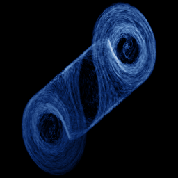

# Chua

`chua` · flow · 3-D · family: Flows



Chua's circuit — the double scroll from a real electronic oscillator with a piecewise-linear diode.

## Equations

```text
h = m1 · x + 0.5 · (m0 − m1) · (abs(x + 1) − abs(x − 1))
dx/dt = α · (y − x − h)
dy/dt = x − y + z
dz/dt = −β · y
```

## Parameters

| Name | Default | Range | Meaning |
|---|---|---|---|
| alpha | 15.6 | [8, 20] | α — capacitor ratio. |
| beta | 28 | [20, 40] | β — inductance term. |
| m0 | -1.14286 | [-2, 0] | Inner slope of the Chua diode. |
| m1 | -0.714286 | [-1.5, 0] | Outer slope of the Chua diode. |

Integration: RK4, default dt = 0.005, initial condition (0.7, 0.0, 0.0).

## References

- L. O. Chua, M. Komuro & T. Matsumoto, IEEE Trans. CAS 33 (1986)

## Source (`.atr`)

```text
name: Chua
family: Flows
desc: Chua's circuit — the double scroll from a real electronic oscillator with a piecewise-linear diode.
ref: L. O. Chua, M. Komuro & T. Matsumoto, IEEE Trans. CAS 33 (1986)
tags: flow, 3d
dt: 0.005
ic: 0.7 0 0
camera: 25 20 0 1

param alpha = 15.6 [8, 20] "α — capacitor ratio."
param beta = 28 [20, 40] "β — inductance term."
param m0 = -8/7 [-2, 0] "Inner slope of the Chua diode."
param m1 = -5/7 [-1.5, 0] "Outer slope of the Chua diode."

h = m1*x + 0.5*(m0 - m1)*(abs(x + 1) - abs(x - 1))
dx = alpha*(y - x - h)
dy = x - y + z
dz = -beta*y
```

Render it: `attractr render chua --size 2048x2048 --report md`
