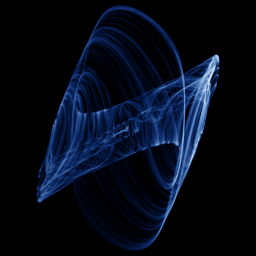

# Coullet

`coullet` · flow · 3-D · family: Flows



The Coullet parametrisation of the Arneodo jerk system.

## Equations

```text
dx/dt = y
dy/dt = z
dz/dt = −a · x − b · y − c · z + d · x³
```

## Parameters

| Name | Default | Range | Meaning |
|---|---|---|---|
| a | -0.8 | [-1.5, 0] |  |
| b | 1.1 | [0.5, 2] |  |
| c | 0.45 | [0.1, 1] |  |
| d | -1 | [-2, 0] |  |

Integration: RK4, default dt = 0.02, initial condition (0.1, 0.1, 0.1, 0.0).

## Source (`.atr`)

```text
name: Coullet
family: Flows
desc: The Coullet parametrisation of the Arneodo jerk system.

tags: flow, 3d
dt: 0.02
ic: 0.1 0.1 0.1
camera: 25 20 0 1

param a = -0.8 [-1.5, 0]
param b = 1.1 [0.5, 2]
param c = 0.45 [0.1, 1]
param d = -1.0 [-2, 0]

dx = y
dy = z
dz = -a*x - b*y - c*z + d*x^3
```

Render it: `attractr render coullet --size 2048x2048 --report md`
