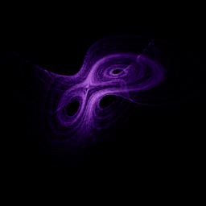

# Dadras

`dadras` · flow · 3-D · family: Flows



A generic chaotic flow with many control knobs — wide range of forms, from elegant ribbons to dense multi-scroll storms. Chaoscope's "Chaotic Flow".

## Equations

```text
dx/dt = y − a · x + b · y · z
dy/dt = c · y − x · z + z
dz/dt = d · x · y − e · z
```

## Parameters

| Name | Default | Range | Meaning |
|---|---|---|---|
| a | 3 | [1, 5] | Primary drive on the X axis. |
| b | 2.7 | [1, 5] | y·z coupling into x. |
| c | 1.7 | [0.5, 3] | Linear growth of y. |
| d | 2 | [1, 4] | x·y coupling into z. |
| e | 9 | [5, 15] | Damping of z. |

Integration: RK4, default dt = 0.005, initial condition (1.1, 2.1, -2.0).

## References

- S. Dadras & H. R. Momeni, Phys. Lett. A 373 (2009)

## Source (`.atr`)

```text
name: Dadras
family: Flows
desc: A generic chaotic flow with many control knobs — wide range of forms, from elegant ribbons to dense multi-scroll storms. Chaoscope's "Chaotic Flow".
ref: S. Dadras & H. R. Momeni, Phys. Lett. A 373 (2009)
tags: flow, 3d
dt: 0.005
ic: 1.1 2.1 -2
camera: 25 20 0 1
palette: aurora
param a = 3.0 [1, 5] "Primary drive on the X axis."
param b = 2.7 [1, 5] "y·z coupling into x."
param c = 1.7 [0.5, 3] "Linear growth of y."
param d = 2.0 [1, 4] "x·y coupling into z."
param e = 9.0 [5, 15] "Damping of z."

dx = y - a*x + b*y*z
dy = c*y - x*z + z
dz = d*x*y - e*z
```

Render it: `attractr render dadras --size 2048x2048 --report md`
