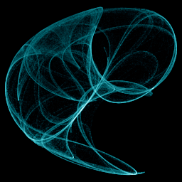

# Peter de Jong

`de_jong` · map · 3-D · family: Maps



Cousin of Clifford with stronger nonlinearity — produces dense filigree and shell-like layered patterns. Lifted into 3-D by a third sine/cosine pair.

## Equations

```text
x′ = sin(a · y) − cos(b · x)
y′ = sin(c · x) − cos(d · y)
z′ = sin(e · z) − cos(f · y)
```

## Parameters

| Name | Default | Range | Meaning |
|---|---|---|---|
| a | -2 | [-3, 3] | Primary X stretch — wider values pull the orbit horizontally. |
| b | -2 | [-3, 3] | X cosine fold. |
| c | -1.2 | [-3, 3] | Primary Y stretch. |
| d | 2 | [-3, 3] | Y cosine fold. |
| e | 1.8 | [-3, 3] | Depth sine drive (e = f = 0 gives the flat 2-D map). |
| f | -1.5 | [-3, 3] | Depth cosine coupling to y. |

## References

- https://paulbourke.net/fractals/peterdejong/

## Source (`.atr`)

```text
name: Peter de Jong
family: Maps
desc: Cousin of Clifford with stronger nonlinearity — produces dense filigree and shell-like layered patterns. Lifted into 3-D by a third sine/cosine pair.
ref: https://paulbourke.net/fractals/peterdejong/
tags: map, classic, 3d
warmup: 200
camera: 0 0 0 1
palette: electric

param a = -2.0 [-3, 3] "Primary X stretch — wider values pull the orbit horizontally."
param b = -2.0 [-3, 3] "X cosine fold."
param c = -1.2 [-3, 3] "Primary Y stretch."
param d = 2.0 [-3, 3] "Y cosine fold."
param e = 1.8 [-3, 3] "Depth sine drive (e = f = 0 gives the flat 2-D map)."
param f = -1.5 [-3, 3] "Depth cosine coupling to y."

x' = sin(a*y) - cos(b*x)
y' = sin(c*x) - cos(d*y)
z' = sin(e*z) - cos(f*y)
```

Render it: `attractr render de_jong --size 2048x2048 --report md`
