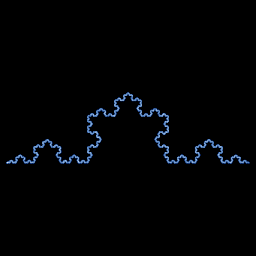

# de Rham curve

`de_rham` · ifs · 2-D · family: IFS



Georges de Rham's two-map family d₀(z) = a·z, d₁(z) = a + (1 − a)·z on the complex plane. One complex parameter a sweeps through the Lévy C curve (a = ½ + ½i), Cesàro curves, and — with the conjugate option — the Koch curve (a = ½ + i√3/6) and the Peano curve (a = ½ + ½i).

## Equations

```text
yy = select(conj = 1, −y, y)
with p = 1:
    x′ = ar · x − ai · yy
    y′ = ai · x + ar · yy
with p = 1:
    x′ = ar + (1 − ar) · x + ai · yy
    y′ = ai − ai · x + (1 − ar) · yy
```

## Parameters

| Name | Default | Range | Meaning |
|---|---|---|---|
| ar | 0.5 | [0, 1] | Re(a). |
| ai | 0.2887 | [-0.7, 0.7] | Im(a). |
| conj | 1 | [0, 1] | 1: Koch–Peano family (maps use the conjugate of z), 0: Cesàro family. |

## References

- G. de Rham, "Sur quelques courbes définies par des équations fonctionnelles" (1957)

## Source (`.atr`)

```text
name: de Rham curve
family: IFS
desc: Georges de Rham's two-map family d₀(z) = a·z, d₁(z) = a + (1 − a)·z on the complex plane. One complex parameter a sweeps through the Lévy C curve (a = ½ + ½i), Cesàro curves, and — with the conjugate option — the Koch curve (a = ½ + i√3/6) and the Peano curve (a = ½ + ½i).
ref: G. de Rham, "Sur quelques courbes définies par des équations fonctionnelles" (1957)
tags: ifs, 2d, classic
dims: 2
warmup: 20
ic: 0.5 0.3 0

param ar = 0.5 [0, 1] "Re(a)."
param ai = 0.2887 [-0.7, 0.7] "Im(a)."
param conj = 1 [0, 1] int "1: Koch–Peano family (maps use the conjugate of z), 0: Cesàro family."

yy = select(conj == 1, -y, y)
choose {
  1: x' = ar*x - ai*yy;              y' = ai*x + ar*yy
  1: x' = ar + (1 - ar)*x + ai*yy;   y' = ai - ai*x + (1 - ar)*yy
}
```

Render it: `attractr render de_rham --size 2048x2048 --report md`
