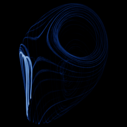

# Dequan Li

`dequan_li` · flow · 3-D · family: Flows



A three-scroll attractor with very fast dynamics — needs a tiny time step.

## Equations

```text
dx/dt = a · (y − x) + d · x · z
dy/dt = k · x + f · y − x · z
dz/dt = c · z + x · y − ε · x²
```

## Parameters

| Name | Default | Range | Meaning |
|---|---|---|---|
| a | 40 | [30, 50] |  |
| c | 1.83333 | [1, 3] |  |
| d | 0.16 | [0, 0.5] |  |
| eps | 0.65 | [0, 1] |  |
| k | 55 | [40, 70] |  |
| f | 20 | [10, 30] |  |

Integration: RK4, default dt = 0.0005, initial condition (0.349, 0.0, -0.16).

## References

- D. Li, Phys. Lett. A 372 (2008)

## Source (`.atr`)

```text
name: Dequan Li
family: Flows
desc: A three-scroll attractor with very fast dynamics — needs a tiny time step.
ref: D. Li, Phys. Lett. A 372 (2008)
tags: flow, 3d
dt: 0.0005
ic: 0.349 0 -0.16
camera: 25 20 0 1

param a = 40 [30, 50]
param c = 11/6 [1, 3]
param d = 0.16 [0, 0.5]
param eps = 0.65 [0, 1]
param k = 55 [40, 70]
param f = 20 [10, 30]

dx = a*(y - x) + d*x*z
dy = k*x + f*y - x*z
dz = c*z + x*y - eps*x^2
```

Render it: `attractr render dequan_li --size 2048x2048 --report md`
