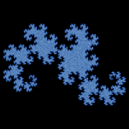

# Heighway dragon

`dragon_curve` · ifs · 2-D · family: IFS



The dragon curve as a two-map IFS (two similarity maps of ratio 1/√2 at ±45°).

## Equations

```text
a = th · 3.141592654 / 180
with p = 1:
    x′ = r · (x · cos(a) − y · sin(a))
    y′ = r · (x · sin(a) + y · cos(a))
with p = 1:
    x′ = 1 − r · (x · cos(a) + y · sin(a))
    y′ = r · (x · sin(a) − y · cos(a))
```

## Parameters

| Name | Default | Range | Meaning |
|---|---|---|---|
| r | 0.7071 | [0.5, 0.8] | Contraction ratio (1/√2 is the dragon). |
| th | 45 | [20, 70] | Rotation angle in degrees. |

## Source (`.atr`)

```text
name: Heighway dragon
family: IFS
desc: The dragon curve as a two-map IFS (two similarity maps of ratio 1/√2 at ±45°).
tags: ifs, 2d, classic
dims: 2
warmup: 20
ic: 0.5 0.5 0

param r = 0.7071 [0.5, 0.8] "Contraction ratio (1/√2 is the dragon)."
param th = 45 [20, 70] "Rotation angle in degrees."

a = th*pi/180
choose {
  1: x' = r*(x*cos(a) - y*sin(a));        y' = r*(x*sin(a) + y*cos(a))
  1: x' = 1 - r*(x*cos(a) + y*sin(a));    y' = r*(x*sin(a) - y*cos(a))
}
```

Render it: `attractr render dragon_curve --size 2048x2048 --report md`
