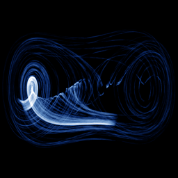

# Duffing (driven)

`duffing_driven` · flow · 2-D · family: Flows



The periodically forced Duffing oscillator x'' + δx' − x + x³ = γ cos(ωt). Time is carried in the 4th state variable w (dw = 1) and only (x, x') is plotted, so the picture is the phase-plane flow of a 2-D non-autonomous system.

## Equations

```text
dx/dt = y
dy/dt = x − x³ − δ · y + γ · cos(ω · w)
dz/dt = 0
dw = 1
plot = x, y, 0
```

## Parameters

| Name | Default | Range | Meaning |
|---|---|---|---|
| delta | 0.3 | [0, 1] | δ — damping. |
| gamma | 0.5 | [0, 1] | γ — forcing amplitude. |
| omega | 1.2 | [0.5, 2] | ω — forcing frequency. |

Integration: RK4, default dt = 0.01, initial condition (0.1, 0.0, 0.0, 0.0).

## References

- G. Duffing (1918); J. Guckenheimer & P. Holmes, "Nonlinear Oscillations, Dynamical Systems, and Bifurcations of Vector Fields" (1983)

## Source (`.atr`)

```text
name: Duffing (driven)
family: Flows
desc: The periodically forced Duffing oscillator x'' + δx' − x + x³ = γ cos(ωt). Time is carried in the 4th state variable w (dw = 1) and only (x, x') is plotted, so the picture is the phase-plane flow of a 2-D non-autonomous system.
ref: G. Duffing (1918); J. Guckenheimer & P. Holmes, "Nonlinear Oscillations, Dynamical Systems, and Bifurcations of Vector Fields" (1983)
tags: flow, driven, 2d
dt: 0.01
ic: 0.1 0 0 0
camera: 0 0 0 1

param delta = 0.3 [0, 1] "δ — damping."
param gamma = 0.5 [0, 1] "γ — forcing amplitude."
param omega = 1.2 [0.5, 2] "ω — forcing frequency."

dx = y
dy = x - x^3 - delta*y + gamma*cos(omega*w)
dz = 0
dw = 1
plot = x, y, 0
```

Render it: `attractr render duffing_driven --size 2048x2048 --report md`
