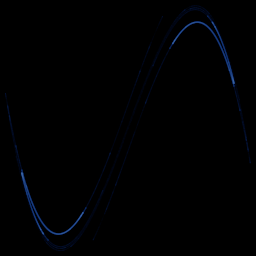

# Duffing map

`duffing_map` · map · 2-D · family: Maps



Discrete Duffing oscillator (Holmes map) — a folded ribbon with a cubic kink.

## Equations

```text
x′ = y
y′ = −b · x + a · y − y³
```

## Parameters

| Name | Default | Range | Meaning |
|---|---|---|---|
| a | 2.75 | [2, 3] |  |
| b | 0.2 | [0, 0.5] |  |

## References

- P. Holmes, Phil. Trans. R. Soc. A 292 (1979)

## Source (`.atr`)

```text
name: Duffing map
family: Maps
desc: Discrete Duffing oscillator (Holmes map) — a folded ribbon with a cubic kink.
ref: P. Holmes, Phil. Trans. R. Soc. A 292 (1979)
tags: map, 2d
dims: 2
ic: 0.1 0.1 0
warmup: 200

param a = 2.75 [2, 3]
param b = 0.2 [0, 0.5]

x' = y
y' = -b*x + a*y - y^3
```

Render it: `attractr render duffing_map --size 2048x2048 --report md`
