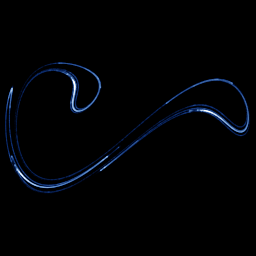

# Duffing (stroboscopic map)

`duffing_strobe` · flow · 2-D · family: Flows



The driven Duffing oscillator sampled once per forcing period. This Poincaré section is the classic "Duffing strange attractor" picture — a fractal crescent that you can zoom into. Only one step in ~500 is plotted, so the iteration budget is boosted 300× (renders take longer).

## Equations

```text
dx/dt = y
dy/dt = x − x³ − δ · y + γ · cos(ω · w)
dz/dt = 0
dw = 1
plot = x, y, 0
section = sin(ω · w / 2 − phase · 3.141592654 / 360)
```

## Parameters

| Name | Default | Range | Meaning |
|---|---|---|---|
| delta | 0.3 | [0, 1] | δ — damping. |
| gamma | 0.5 | [0, 1] | γ — forcing amplitude. |
| omega | 1.2 | [0.5, 2] | ω — forcing frequency. |
| phase | 0 | [0, 360] | Phase (degrees) of the strobe within the forcing period. |

Integration: RK4, default dt = 0.01, initial condition (0.1, 0.0, 0.0, 0.0).

## References

- J. Guckenheimer & P. Holmes (1983); F. C. Moon, "Chaotic Vibrations" (1987)

## Source (`.atr`)

```text
name: Duffing (stroboscopic map)
family: Flows
desc: The driven Duffing oscillator sampled once per forcing period. This Poincaré section is the classic "Duffing strange attractor" picture — a fractal crescent that you can zoom into. Only one step in ~500 is plotted, so the iteration budget is boosted 300× (renders take longer).
ref: J. Guckenheimer & P. Holmes (1983); F. C. Moon, "Chaotic Vibrations" (1987)
tags: flow, driven, section, 2d
dt: 0.01
ic: 0.1 0 0 0
camera: 0 0 0 1
warmup: 5000
boost: 300

param delta = 0.3 [0, 1] "δ — damping."
param gamma = 0.5 [0, 1] "γ — forcing amplitude."
param omega = 1.2 [0.5, 2] "ω — forcing frequency."
param phase = 0 [0, 360] "Phase (degrees) of the strobe within the forcing period."

dx = y
dy = x - x^3 - delta*y + gamma*cos(omega*w)
dz = 0
dw = 1
plot = x, y, 0
section = sin(omega*w/2 - phase*pi/360)
```

Render it: `attractr render duffing_strobe --size 2048x2048 --report md`
