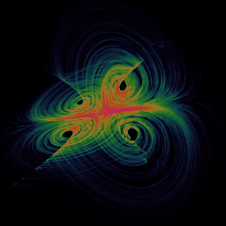

# Four-wing

`fourwing` · flow · 3-D · family: Flows



Four symmetric wings joined at the centre — one of the prettiest multi-wing systems.

## Equations

```text
dx/dt = a · x + c · y · z
dy/dt = b · x + d · y − x · z
dz/dt = e · z + f · x · y
```

## Parameters

| Name | Default | Range | Meaning |
|---|---|---|---|
| a | 0.2 | [0, 0.5] |  |
| b | -0.01 | [-0.1, 0.1] |  |
| c | 1 | [0.5, 1.5] |  |
| d | -0.4 | [-1, 0] |  |
| e | -1 | [-2, 0] |  |
| f | -1 | [-2, 0] |  |

Integration: RK4, default dt = 0.05, initial condition (1.0, 1.0, 1.0, 0.0).

## References

- Four-wing attractor — arXiv:2507.07577, Eq. 3.1

## Source (`.atr`)

```text
name: Four-wing
family: Flows
desc: Four symmetric wings joined at the centre — one of the prettiest multi-wing systems.
ref: Four-wing attractor — arXiv:2507.07577, Eq. 3.1
tags: flow, 3d
dt: 0.05
ic: 1 1 1
camera: 25 20 0 1
palette: chaoscope
param a = 0.2 [0, 0.5]
param b = -0.01 [-0.1, 0.1]
param c = 1.0 [0.5, 1.5]
param d = -0.4 [-1, 0]
param e = -1.0 [-2, 0]
param f = -1.0 [-2, 0]

dx = a*x + c*y*z
dy = b*x + d*y - x*z
dz = e*z + f*x*y
```

Render it: `attractr render fourwing --size 2048x2048 --report md`
