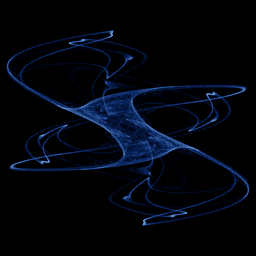

# Fractal Dream

`fractal_dream` · map · 2-D · family: Maps



Pickover's "Latoocarfian" map (the WebGL experiment's "Fractal Dream") — silky, flowing sheets of sine waves.

## Equations

```text
x′ = sin(b · y) + c · sin(b · x)
y′ = sin(a · x) + d · sin(a · y)
```

## Parameters

| Name | Default | Range | Meaning |
|---|---|---|---|
| a | -0.966918 | [-3, 3] | Y → X sine frequency. |
| b | 2.87988 | [-3, 3] | X → Y sine frequency. |
| c | 0.765145 | [-1.5, 1.5] | Self-coupling gain of x. |
| d | 0.744728 | [-1.5, 1.5] | Self-coupling gain of y. |

## References

- C. A. Pickover, "Chaos in Wonderland" (1994)

## Source (`.atr`)

```text
name: Fractal Dream
family: Maps
desc: Pickover's "Latoocarfian" map (the WebGL experiment's "Fractal Dream") — silky, flowing sheets of sine waves.
ref: C. A. Pickover, "Chaos in Wonderland" (1994)
tags: map, 2d
dims: 2
warmup: 100

param a = -0.966918 [-3, 3] "Y → X sine frequency."
param b = 2.879879 [-3, 3] "X → Y sine frequency."
param c = 0.765145 [-1.5, 1.5] "Self-coupling gain of x."
param d = 0.744728 [-1.5, 1.5] "Self-coupling gain of y."

x' = sin(b*y) + c*sin(b*x)
y' = sin(a*x) + d*sin(a*y)
```

Render it: `attractr render fractal_dream --size 2048x2048 --report md`
