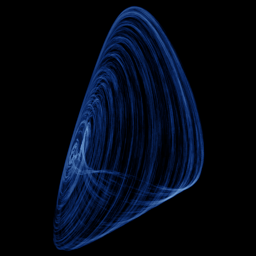

# Genesio-Tesi

`genesio_tesi` · flow · 3-D · family: Flows



A jerk system from control theory — a single folded scroll.

## Equations

```text
dx/dt = y
dy/dt = z
dz/dt = −c · x − b · y − a · z + x²
```

## Parameters

| Name | Default | Range | Meaning |
|---|---|---|---|
| a | 0.44 | [0.2, 0.6] |  |
| b | 1.1 | [0.8, 1.4] |  |
| c | 1 | [0.8, 1.2] |  |

Integration: RK4, default dt = 0.01, initial condition (0.1, 0.1, 0.1, 0.0).

## References

- R. Genesio & A. Tesi, Automatica 28 (1992)

## Source (`.atr`)

```text
name: Genesio-Tesi
family: Flows
desc: A jerk system from control theory — a single folded scroll.
ref: R. Genesio & A. Tesi, Automatica 28 (1992)
tags: flow, 3d
dt: 0.01
ic: 0.1 0.1 0.1
camera: 25 20 0 1

param a = 0.44 [0.2, 0.6]
param b = 1.1 [0.8, 1.4]
param c = 1.0 [0.8, 1.2]

dx = y
dy = z
dz = -c*x - b*y - a*z + x^2
```

Render it: `attractr render genesio_tesi --size 2048x2048 --report md`
