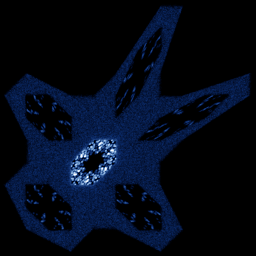

# Gingerbreadman

`gingerbreadman` · map · 2-D · family: Maps



Devaney's gingerbreadman — a chaotic region shaped like a gingerbread cookie, surrounded by stable hexagonal islands.

## Equations

```text
x′ = 1 − y + abs(x)
y′ = x
```

## References

- R. L. Devaney, "An Introduction to Chaotic Dynamical Systems"

## Source (`.atr`)

```text
name: Gingerbreadman
family: Maps
desc: Devaney's gingerbreadman — a chaotic region shaped like a gingerbread cookie, surrounded by stable hexagonal islands.
ref: R. L. Devaney, "An Introduction to Chaotic Dynamical Systems"
tags: map, 2d
dims: 2
ic: -0.1 0 0
jitter: 1.5
warmup: 20

x' = 1 - y + abs(x)
y' = x
```

Render it: `attractr render gingerbreadman --size 2048x2048 --report md`
