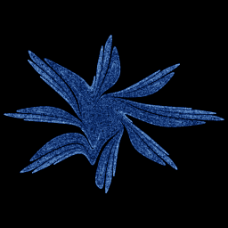

# Gumowski-Mira (extended)

`gumowski_mira_b` · map · 2-D · family: Maps



The Gumowski–Mira recurrence with the damping shape b and an exponential variant of the nonlinearity f(x) exposed as parameters. Sweeping μ walks through seashells, clouds and "pearl" rings.

## Equations

```text
f1 = μ · x + 2 · (1 − μ) · x² / (1 + x²)
f2 = μ · x + (1 − μ) · x² · exp((1 − x²) / 4)
fx = mix(f1, f2, s)
x′ = y + a · (1 − b · y²) · y + fx
g1 = μ · x′ + 2 · (1 − μ) · x′² / (1 + x′²)
g2 = μ · x′ + (1 − μ) · x′² · exp((1 − x′²) / 4)
y′ = −x + mix(g1, g2, s)
```

## Parameters

| Name | Default | Range | Meaning |
|---|---|---|---|
| a | 0.008 | [-1, 1] | Damping strength. |
| b | 0.05 | [0, 1] | Shape of the damping term (1 − b·y²). |
| mu | -0.7 | [-1, 1] | μ — shape of f(x). |
| s | 0 | [0, 1] | Blend between the rational f (0) and the exponential f (1). |

## References

- I. Gumowski & C. Mira, "Recurrences and Discrete Dynamic Systems" (1980)

## Source (`.atr`)

```text
name: Gumowski-Mira (extended)
family: Maps
desc: The Gumowski–Mira recurrence with the damping shape b and an exponential variant of the nonlinearity f(x) exposed as parameters. Sweeping μ walks through seashells, clouds and "pearl" rings.
ref: I. Gumowski & C. Mira, "Recurrences and Discrete Dynamic Systems" (1980)
tags: map, 2d
warmup: 200
dims: 2

param a = 0.008 [-1, 1] "Damping strength."
param b = 0.05 [0, 1] "Shape of the damping term (1 − b·y²)."
param mu = -0.7 [-1, 1] "μ — shape of f(x)."
param s = 0 [0, 1] "Blend between the rational f (0) and the exponential f (1)."

f1  = mu*x + 2*(1 - mu)*x^2/(1 + x^2)
f2  = mu*x + (1 - mu)*x^2*exp((1 - x^2)/4)
fx  = mix(f1, f2, s)
x'  = y + a*(1 - b*y^2)*y + fx
g1  = mu*x' + 2*(1 - mu)*x'^2/(1 + x'^2)
g2  = mu*x' + (1 - mu)*x'^2*exp((1 - x'^2)/4)
y'  = -x + mix(g1, g2, s)
```

Render it: `attractr render gumowski_mira_b --size 2048x2048 --report md`
