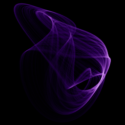

# Halvorsen

`halvorsen` · flow · 3-D · family: Flows



Cyclically symmetric — the same equation cycled through x, y and z. Folds into interlocking torus-knot loops, like a 3-D pretzel.

## Equations

```text
dx/dt = −a · x − 4 · y − 4 · z − y²
dy/dt = −a · y − 4 · z − 4 · x − z²
dz/dt = −a · z − 4 · x − 4 · y − x²
```

## Parameters

| Name | Default | Range | Meaning |
|---|---|---|---|
| a | 1.4 | [1, 2.5] | Damping — lower values loosen the loops; near 1.4 the orbit barely stays bound (1.89 is the Chaoscope preset). |

Integration: RK4, default dt = 0.005, initial condition (-5.0, 0.0, 0.0, 0.0).

## References

- arXiv:2601.21117 (Attractors section)

## Source (`.atr`)

```text
name: Halvorsen
family: Flows
desc: Cyclically symmetric — the same equation cycled through x, y and z. Folds into interlocking torus-knot loops, like a 3-D pretzel.
ref: arXiv:2601.21117 (Attractors section)
tags: flow, 3d
dt: 0.005
ic: -5 0 0
camera: 30 20 0 1
palette: aurora
param a = 1.4 [1.0, 2.5] "Damping — lower values loosen the loops; near 1.4 the orbit barely stays bound (1.89 is the Chaoscope preset)."

dx = -a*x - 4*y - 4*z - y^2
dy = -a*y - 4*z - 4*x - z^2
dz = -a*z - 4*x - 4*y - x^2
```

Render it: `attractr render halvorsen --size 2048x2048 --report md`
