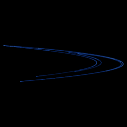

# Hénon

`henon` · map · 2-D · family: Maps



The canonical strange attractor — Michel Hénon's 1976 map. Its orbit settles onto a delicate banana-shaped curve that, zoomed in, reveals endless self-similar fractal bands.

## Equations

```text
x′ = 1 − a · x² + y
y′ = b · x
```

## Parameters

| Name | Default | Range | Meaning |
|---|---|---|---|
| a | 1.4 | [1, 1.42] | Nonlinear fold — the squared term that bends the curve. Near 1.4 gives the classic shape; above ≈ 1.42 the orbit escapes. |
| b | 0.3 | [0.1, 0.35] | Contraction — how strongly area shrinks each step (|b| < 1). |

## References

- M. Hénon, "A two-dimensional mapping with a strange attractor", Comm. Math. Phys. 50 (1976)

## Source (`.atr`)

```text
name: Hénon
family: Maps
desc: The canonical strange attractor — Michel Hénon's 1976 map. Its orbit settles onto a delicate banana-shaped curve that, zoomed in, reveals endless self-similar fractal bands.
ref: M. Hénon, "A two-dimensional mapping with a strange attractor", Comm. Math. Phys. 50 (1976)
tags: map, classic, 2d
dims: 2
warmup: 200
ic: 0 0 0
lyapunov: 0.419

param a = 1.4 [1.0, 1.42] "Nonlinear fold — the squared term that bends the curve. Near 1.4 gives the classic shape; above ≈ 1.42 the orbit escapes."
param b = 0.3 [0.1, 0.35] "Contraction — how strongly area shrinks each step (|b| < 1)."

x' = 1 - a*x^2 + y
y' = b*x
```

Render it: `attractr render henon --size 2048x2048 --report md`
