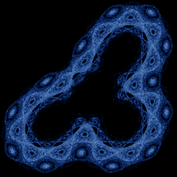

# Hopalong

`hopalong` · map · 2-D · family: Maps



Barry Martin's Hopalong — the "Martin attractor" made famous by Scientific American's Computer Recreations (1986). Square-root kinks give it a beaded, lace-like texture.

## Equations

```text
x′ = y − sign(x) · sqrt(abs(b · x − c))
y′ = a − x
```

## Parameters

| Name | Default | Range | Meaning |
|---|---|---|---|
| a | 2 | [-5, 5] |  |
| b | 1 | [-5, 5] |  |
| c | 0 | [-5, 5] |  |

## References

- A. K. Dewdney, Scientific American, Sept. 1986

## Source (`.atr`)

```text
name: Hopalong
family: Maps
desc: Barry Martin's Hopalong — the "Martin attractor" made famous by Scientific American's Computer Recreations (1986). Square-root kinks give it a beaded, lace-like texture.
ref: A. K. Dewdney, Scientific American, Sept. 1986
tags: map, 2d, classic
dims: 2
ic: 0 0 0
jitter: 0.5
warmup: 50

param a = 2.0 [-5, 5]
param b = 1.0 [-5, 5]
param c = 0.0 [-5, 5]

x' = y - sign(x)*sqrt(abs(b*x - c))
y' = a - x
```

Render it: `attractr render hopalong --size 2048x2048 --report md`
