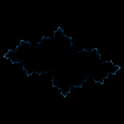

# Julia (complex)

`julia_2d` · map · 2-D · family: Julia



The classic Julia set of z² + c drawn by inverse iteration (random square-root branch) — a flat special case of the quaternion version.

## Equations

```text
tw = x − c_re
ti = y − c_im
r = sqrt(sqrt(tw · tw + ti · ti))
th = 0.5 · atan2(ti, tw) + select(rand() < 0.5, 0, 3.141592654)
x′ = r · cos(th)
y′ = r · sin(th)
```

## Parameters

| Name | Default | Range | Meaning |
|---|---|---|---|
| c_re | -0.7 | [-2, 1] |  |
| c_im | 0.27 | [-1.5, 1.5] |  |

## Source (`.atr`)

```text
name: Julia (complex)
family: Julia
desc: The classic Julia set of z² + c drawn by inverse iteration (random square-root branch) — a flat special case of the quaternion version.
tags: julia, fractal, 2d
dims: 2
ic: 0.5 0.5 0
warmup: 30
palette: ice

param c_re = -0.7 [-2, 1]
param c_im = 0.27 [-1.5, 1.5]

tw = x - c_re
ti = y - c_im
r  = sqrt(sqrt(tw*tw + ti*ti))
th = 0.5*atan2(ti, tw) + select(rand() < 0.5, 0, pi)
x' = r*cos(th)
y' = r*sin(th)
```

Render it: `attractr render julia_2d --size 2048x2048 --report md`
