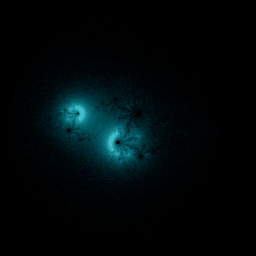

# Julia (escape orbits)

`julia_escape` · escape · 2-D · family: Escape



Orbits of z → z² + c for a fixed c, started from random points of the plane and kept only if they escape — the complement of the filled Julia set, drawn by the paths the escaping points take. Change c to visit any Julia set; points that never escape (the filled set) stay dark.

## Equations

```text
x′ = x · x − y · y + c_re
y′ = 2 · x · y + c_im
color = w
```

## Parameters

| Name | Default | Range | Meaning |
|---|---|---|---|
| c_re | -0.8 | [-2, 1] |  |
| c_im | 0.156 | [-1.5, 1.5] |  |

## References

- G. Julia, "Mémoire sur l'itération des fonctions rationnelles" (1918); M. Green, "The Buddhabrot Technique" (1993)

## Source (`.atr`)

```text
name: Julia (escape orbits)
family: Escape
desc: Orbits of z → z² + c for a fixed c, started from random points of the plane and kept only if they escape — the complement of the filled Julia set, drawn by the paths the escaping points take. Change c to visit any Julia set; points that never escape (the filled set) stay dark.
ref: G. Julia, "Mémoire sur l'itération des fonctions rationnelles" (1918); M. Green, "The Buddhabrot Technique" (1993)
tags: escape, julia, fractal, 2d
kind: escape
dims: 2
region: -2.0 2.0 -2.0 2.0
bailout: 2
max_iter: 300
min_iter: 5
boost: 10
camera: 0 0 0 1
palette: electric

param c_re = -0.8 [-2, 1]
param c_im = 0.156 [-1.5, 1.5]

x' = x*x - y*y + c_re
y' = 2*x*y + c_im
color = w
```

Render it: `attractr render julia_escape --size 2048x2048 --report md`
