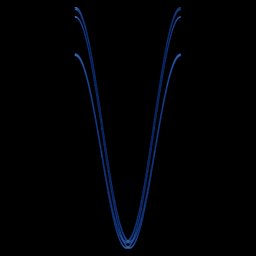

# Kaplan-Yorke

`kaplan_yorke` · map · 2-D · family: Maps



A textbook example with a computable fractal dimension: a Bernoulli shift in x driving a damped cosine in y (a trace of noise replaces the exact integer arithmetic of the original).

## Equations

```text
x′ = mod(2 · x + 1e-09 · rand(), 1)
y′ = α · y + cos(4 · 3.141592654 · x)
```

## Parameters

| Name | Default | Range | Meaning |
|---|---|---|---|
| al | 0.2 | [0.05, 0.95] | α — contraction of y (dimension = 1 + ln2/|ln α|). |

## References

- J. L. Kaplan & J. A. Yorke (1979)

## Source (`.atr`)

```text
name: Kaplan-Yorke
family: Maps
desc: A textbook example with a computable fractal dimension: a Bernoulli shift in x driving a damped cosine in y (a trace of noise replaces the exact integer arithmetic of the original).
ref: J. L. Kaplan & J. A. Yorke (1979)
tags: map, 2d
dims: 2
ic: 0.1234 0.1 0
warmup: 50

param al = 0.2 [0.05, 0.95] "α — contraction of y (dimension = 1 + ln2/|ln α|)."

x' = mod(2*x + 1e-9*rand(), 1)   # tiny noise keeps the doubling map from collapsing in floating point
y' = al*y + cos(4*pi*x)
```

Render it: `attractr render kaplan_yorke --size 2048x2048 --report md`
