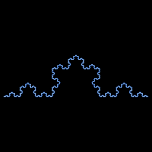

# Koch curve

`koch_snowflake` · ifs · 2-D · family: IFS



Helge von Koch's 1904 curve as a four-map IFS (ratio 1/3, two of the copies rotated ±60°). The angle is exposed: 60° is Koch, other values give spiky or flattened variants.

## Equations

```text
a = deg · 3.141592654 / 180
ca = cos(a) · s
sa = sin(a) · s
with p = 1:
    x′ = s · x
    y′ = s · y
with p = 1:
    x′ = ca · x − sa · y + s
    y′ = sa · x + ca · y
with p = 1:
    x′ = ca · x + sa · y + s + ca
    y′ = −sa · x + ca · y + sa
with p = 1:
    x′ = s · x + 1 − s
    y′ = s · y
```

## Parameters

| Name | Default | Range | Meaning |
|---|---|---|---|
| s | 0.3333 | [0.2, 0.5] | Contraction ratio. |
| deg | 60 | [20, 90] | Angle of the two middle segments (degrees). |

## References

- H. von Koch, "Sur une courbe continue sans tangente" (1904)

## Source (`.atr`)

```text
name: Koch curve
family: IFS
desc: Helge von Koch's 1904 curve as a four-map IFS (ratio 1/3, two of the copies rotated ±60°). The angle is exposed: 60° is Koch, other values give spiky or flattened variants.
ref: H. von Koch, "Sur une courbe continue sans tangente" (1904)
tags: ifs, 2d, classic
dims: 2
warmup: 20
ic: 0.5 0 0

param s = 0.3333 [0.2, 0.5] "Contraction ratio."
param deg = 60 [20, 90] "Angle of the two middle segments (degrees)."

a  = deg*pi/180
ca = cos(a)*s
sa = sin(a)*s
choose {
  1: x' = s*x;                      y' = s*y
  1: x' = ca*x - sa*y + s;          y' = sa*x + ca*y
  1: x' = ca*x + sa*y + s + ca;     y' = -sa*x + ca*y + sa
  1: x' = s*x + 1 - s;              y' = s*y
}
```

Render it: `attractr render koch_snowflake --size 2048x2048 --report md`
