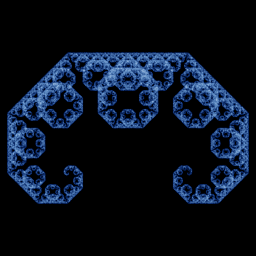

# Lévy C curve

`levy_c` · ifs · 2-D · family: IFS



Paul Lévy's C-curve (1938): two maps of ratio 1/√2 rotated +45° and −45°, meeting tip to tip. Compare with the Heighway dragon, which differs only in the orientation of one copy.

## Equations

```text
a = th · 3.141592654 / 180
with p = 1:
    x′ = r · (x · cos(a) − y · sin(a))
    y′ = r · (x · sin(a) + y · cos(a))
with p = 1:
    x′ = r · (x · cos(a) + y · sin(a)) + 1 − r · cos(a)
    y′ = r · (−x · sin(a) + y · cos(a)) + r · sin(a)
```

## Parameters

| Name | Default | Range | Meaning |
|---|---|---|---|
| r | 0.7071 | [0.5, 0.8] | Contraction ratio (1/√2 is the C curve). |
| th | 45 | [20, 70] | Rotation angle in degrees. |

## References

- P. Lévy, "Plane or space curves and surfaces consisting of parts similar to the whole" (1938)

## Source (`.atr`)

```text
name: Lévy C curve
family: IFS
desc: Paul Lévy's C-curve (1938): two maps of ratio 1/√2 rotated +45° and −45°, meeting tip to tip. Compare with the Heighway dragon, which differs only in the orientation of one copy.
ref: P. Lévy, "Plane or space curves and surfaces consisting of parts similar to the whole" (1938)
tags: ifs, 2d, classic
dims: 2
warmup: 20
ic: 0.5 0.5 0

param r = 0.7071 [0.5, 0.8] "Contraction ratio (1/√2 is the C curve)."
param th = 45 [20, 70] "Rotation angle in degrees."

a = th*pi/180
choose {
  1: x' = r*(x*cos(a) - y*sin(a));         y' = r*(x*sin(a) + y*cos(a))
  1: x' = r*(x*cos(a) + y*sin(a)) + 1 - r*cos(a);  y' = r*(-x*sin(a) + y*cos(a)) + r*sin(a)
}
```

Render it: `attractr render levy_c --size 2048x2048 --report md`
