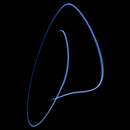

# Linz–Sprott jerk

`linz_sprott` · flow · 3-D · family: Flows



The simplest piecewise-linear chaotic jerk equation x''' = −a·x'' − x' + |x| − 1. The absolute value is the only nonlinearity, yet the orbit folds into a single neat scroll.

## Equations

```text
dx/dt = y
dy/dt = z
dz/dt = −a · z − y + abs(x) − 1
```

## Parameters

| Name | Default | Range | Meaning |
|---|---|---|---|
| a | 0.6 | [0.3, 1] | a — damping; chaos appears below ≈ 0.65. |

Integration: RK4, default dt = 0.02, initial condition (0.5, 0.0, 0.0, 0.0).

## References

- S. J. Linz & J. C. Sprott, "Elementary chaotic flow", Phys. Lett. A 259 (1999)

## Source (`.atr`)

```text
name: Linz–Sprott jerk
family: Flows
desc: The simplest piecewise-linear chaotic jerk equation x''' = −a·x'' − x' + |x| − 1. The absolute value is the only nonlinearity, yet the orbit folds into a single neat scroll.
ref: S. J. Linz & J. C. Sprott, "Elementary chaotic flow", Phys. Lett. A 259 (1999)
tags: flow, jerk, 3d
dt: 0.02
ic: 0.5 0 0
camera: 25 20 0 1

param a = 0.6 [0.3, 1] "a — damping; chaos appears below ≈ 0.65."

dx = y
dy = z
dz = -a*z - y + abs(x) - 1
```

Render it: `attractr render linz_sprott --size 2048x2048 --report md`
