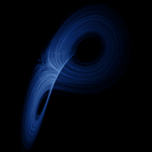

# Lorenz

`lorenz` · flow · 3-D · family: Flows



The famous butterfly. Edward Lorenz's 1963 weather model — the system that made "chaos" a household word.

## Equations

```text
dx/dt = σ · (y − x)
dy/dt = x · (ρ − z) − y
dz/dt = x · y − β · z
```

## Parameters

| Name | Default | Range | Meaning |
|---|---|---|---|
| sigma | 10 | [0, 20] | σ (Prandtl number) — fluid viscosity. Standard value is 10. |
| rho | 28 | [0, 50] | ρ (Rayleigh number) — heating from below. Chaos appears above ≈ 24.74. |
| beta | 2.66667 | [0, 5] | β — geometric aspect ratio of the convection cells. |

Integration: RK4, default dt = 0.005, initial condition (0.1, 0.0, 0.0, 0.0).

## References

- E. N. Lorenz, "Deterministic Nonperiodic Flow", J. Atmos. Sci. 20 (1963)

## Source (`.atr`)

```text
name: Lorenz
family: Flows
desc: The famous butterfly. Edward Lorenz's 1963 weather model — the system that made "chaos" a household word.
ref: E. N. Lorenz, "Deterministic Nonperiodic Flow", J. Atmos. Sci. 20 (1963)
tags: flow, classic, 3d
dt: 0.005
ic: 0.1 0 0
camera: 25 15 0 1
lyapunov: 0.906

param sigma = 10 [0, 20] "σ (Prandtl number) — fluid viscosity. Standard value is 10."
param rho = 28 [0, 50] "ρ (Rayleigh number) — heating from below. Chaos appears above ≈ 24.74."
param beta = 8/3 [0, 5] "β — geometric aspect ratio of the convection cells."

dx = sigma*(y - x)
dy = x*(rho - z) - y
dz = x*y - beta*z
```

Render it: `attractr render lorenz --size 2048x2048 --report md`
