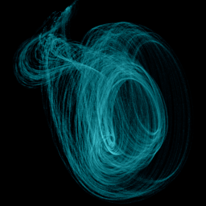

# Lorenz-84

`lorenz84` · flow · 3-D · family: Flows



A low-order model of atmospheric circulation — Edward Lorenz's 1984 "weather in a box" (Hadley circulation). Looping, ribbon-like flows that wander between calm and stormy regimes.

## Equations

```text
dx/dt = −y² − z² − a · x + a · F
dy/dt = x · y − b · x · z − y + G
dz/dt = b · x · y + x · z − z
```

## Parameters

| Name | Default | Range | Meaning |
|---|---|---|---|
| a | 0.25 | [0, 1] | Damping of the westerly wind — how quickly the main flow decays. |
| b | 4 | [0, 8] | Advection — how strongly the wind transports the eddies. |
| F | 8 | [0, 12] | Thermal forcing (equator–pole). |
| G | 1 | [0, 3] | Land–sea thermal forcing. |

Integration: RK4, default dt = 0.01, initial condition (0.1, 0.1, 0.1).

## References

- E. N. Lorenz, "Irregularity: a fundamental property of the atmosphere", Tellus 36A (1984)

## Source (`.atr`)

```text
name: Lorenz-84
family: Flows
desc: A low-order model of atmospheric circulation — Edward Lorenz's 1984 "weather in a box" (Hadley circulation). Looping, ribbon-like flows that wander between calm and stormy regimes.
ref: E. N. Lorenz, "Irregularity: a fundamental property of the atmosphere", Tellus 36A (1984)
tags: flow, 3d
dt: 0.01
ic: 0.1 0.1 0.1
camera: 30 25 0 1
palette: electric
param a = 0.25 [0, 1] "Damping of the westerly wind — how quickly the main flow decays."
param b = 4.0 [0, 8] "Advection — how strongly the wind transports the eddies."
param F = 8.0 [0, 12] "Thermal forcing (equator–pole)."
param G = 1.0 [0, 3] "Land–sea thermal forcing."

dx = -y^2 - z^2 - a*x + a*F
dy = x*y - b*x*z - y + G
dz = b*x*y + x*z - z
```

Render it: `attractr render lorenz84 --size 2048x2048 --report md`
