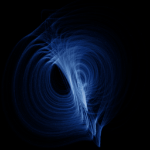

# Lorenz mod 2

`lorenz_mod2` · flow · 3-D · family: Flows



A Lorenz variant with a second quadratic coupling — folded, ribbon-like wings.

## Equations

```text
dx/dt = −a · x + y² − z² + a · c
dy/dt = x · (y − b · z) + d
dz/dt = −z + x · (b · y + z)
```

## Parameters

| Name | Default | Range | Meaning |
|---|---|---|---|
| a | 0.9 | [0.5, 1.5] |  |
| b | 5 | [3, 8] |  |
| c | 9.9 | [5, 15] |  |
| d | 1 | [0, 2] |  |

Integration: RK4, default dt = 0.01, initial condition (0.1, 0.1, 0.1, 0.0).

## Source (`.atr`)

```text
name: Lorenz mod 2
family: Flows
desc: A Lorenz variant with a second quadratic coupling — folded, ribbon-like wings.

tags: flow, 3d
dt: 0.01
ic: 0.1 0.1 0.1
camera: 25 20 0 1

param a = 0.9 [0.5, 1.5]
param b = 5.0 [3, 8]
param c = 9.9 [5, 15]
param d = 1.0 [0, 2]

dx = -a*x + y^2 - z^2 + a*c
dy = x*(y - b*z) + d
dz = -z + x*(b*y + z)
```

Render it: `attractr render lorenz_mod2 --size 2048x2048 --report md`
