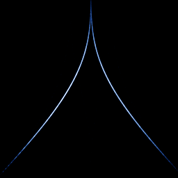

# Lorenz return map

`lorenz_return_map` · flow · 2-D · family: Flows



The "Lorenz map": each successive maximum of z plotted against the previous one (zₙ₊₁ vs zₙ). Lorenz drew this cusp in 1963 to argue that his butterfly behaves like a one-dimensional tent map. The previous maximum is remembered in the 4th state variable w by the on_section block.

## Equations

```text
dx/dt = σ · (y − x)
dy/dt = x · (ρ − z) − y
dz/dt = x · y − β · z
dw = 0
plot = w, z, 0
section = x · y − β · z
at each section crossing:
    w′ = z
```

## Parameters

| Name | Default | Range | Meaning |
|---|---|---|---|
| sigma | 10 | [0, 20] |  |
| rho | 28 | [0, 50] |  |
| beta | 2.66667 | [0, 5] |  |

Integration: RK4, default dt = 0.005, initial condition (0.1, 0.0, 0.0, 0.0).

## References

- E. N. Lorenz, "Deterministic Nonperiodic Flow", J. Atmos. Sci. 20 (1963), Fig. 4

## Source (`.atr`)

```text
name: Lorenz return map
family: Flows
desc: The "Lorenz map": each successive maximum of z plotted against the previous one (zₙ₊₁ vs zₙ). Lorenz drew this cusp in 1963 to argue that his butterfly behaves like a one-dimensional tent map. The previous maximum is remembered in the 4th state variable w by the on_section block.
ref: E. N. Lorenz, "Deterministic Nonperiodic Flow", J. Atmos. Sci. 20 (1963), Fig. 4
tags: flow, section, return map, classic
dt: 0.005
ic: 0.1 0 0 0
camera: 0 0 0 1
warmup: 2000
boost: 40
section_dir: down

param sigma = 10 [0, 20]
param rho = 28 [0, 50]
param beta = 8/3 [0, 5]

dx = sigma*(y - x)
dy = x*(rho - z) - y
dz = x*y - beta*z
dw = 0
plot = w, z, 0
section = x*y - beta*z
on_section { w' = z }
```

Render it: `attractr render lorenz_return_map --size 2048x2048 --report md`
