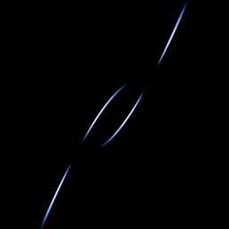

# Lorenz (Poincaré section)

`lorenz_section` · flow · 2-D · family: Flows



The Lorenz flow sampled only when z crosses the plane z = ρ − 1 (the height of the two unstable foci). What is left is the famous "Lorenz map" — a thin, almost one-dimensional set that shows why the butterfly can be reduced to a 1-D return map.

## Equations

```text
dx/dt = σ · (y − x)
dy/dt = x · (ρ − z) − y
dz/dt = x · y − β · z
plot = x, y, 0
section = z − height
```

## Parameters

| Name | Default | Range | Meaning |
|---|---|---|---|
| sigma | 10 | [0, 20] |  |
| rho | 28 | [0, 50] |  |
| beta | 2.66667 | [0, 5] |  |
| height | 27 | [0, 50] | z-level of the section plane. |

Integration: RK4, default dt = 0.005, initial condition (0.1, 0.0, 0.0, 0.0).

## References

- E. N. Lorenz, "Deterministic Nonperiodic Flow", J. Atmos. Sci. 20 (1963)

## Source (`.atr`)

```text
name: Lorenz (Poincaré section)
family: Flows
desc: The Lorenz flow sampled only when z crosses the plane z = ρ − 1 (the height of the two unstable foci). What is left is the famous "Lorenz map" — a thin, almost one-dimensional set that shows why the butterfly can be reduced to a 1-D return map.
ref: E. N. Lorenz, "Deterministic Nonperiodic Flow", J. Atmos. Sci. 20 (1963)
tags: flow, section, classic
dt: 0.005
ic: 0.1 0 0
camera: 0 0 0 1
warmup: 2000
boost: 40

param sigma = 10 [0, 20]
param rho = 28 [0, 50]
param beta = 8/3 [0, 5]
param height = 27 [0, 50] "z-level of the section plane."

dx = sigma*(y - x)
dy = x*(rho - z) - y
dz = x*y - beta*z
plot = x, y, 0
section = z - height
```

Render it: `attractr render lorenz_section --size 2048x2048 --report md`
