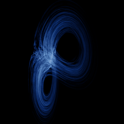

# Lorenz–Stenflo

`lorenz_stenflo` · flow · 3-D · family: Flows



Lennart Stenflo's 1996 extension of the Lorenz equations to rotating atmospheric acoustic-gravity waves — a 4-D system whose projection is a Lorenz butterfly with an extra twist from the coupling s.

## Equations

```text
dx/dt = σ · (y − x) + s · w
dy/dt = x · (r − z) − y
dz/dt = x · y − b · z
dw = −x − σ · w
```

## Parameters

| Name | Default | Range | Meaning |
|---|---|---|---|
| sigma | 1 | [0, 5] | σ — Prandtl number. |
| r | 26 | [0, 50] | r — Rayleigh number. |
| b | 0.7 | [0, 3] | b — geometric factor. |
| s | 1.5 | [0, 5] | s — rotation coupling to the 4th variable. |

Integration: RK4, default dt = 0.005, initial condition (1.0, 1.0, 1.0, 1.0).

## References

- L. Stenflo, "Generalized Lorenz equations for acoustic-gravity waves in the atmosphere", Phys. Scripta 53 (1996)

## Source (`.atr`)

```text
name: Lorenz–Stenflo
family: Flows
desc: Lennart Stenflo's 1996 extension of the Lorenz equations to rotating atmospheric acoustic-gravity waves — a 4-D system whose projection is a Lorenz butterfly with an extra twist from the coupling s.
ref: L. Stenflo, "Generalized Lorenz equations for acoustic-gravity waves in the atmosphere", Phys. Scripta 53 (1996)
tags: flow, 4d, hyperchaos
dt: 0.005
ic: 1 1 1 1
camera: 25 15 0 1
warmup: 3000

param sigma = 1 [0, 5] "σ — Prandtl number."
param r = 26 [0, 50] "r — Rayleigh number."
param b = 0.7 [0, 3] "b — geometric factor."
param s = 1.5 [0, 5] "s — rotation coupling to the 4th variable."

dx = sigma*(y - x) + s*w
dy = x*(r - z) - y
dz = x*y - b*z
dw = -x - sigma*w
```

Render it: `attractr render lorenz_stenflo --size 2048x2048 --report md`
