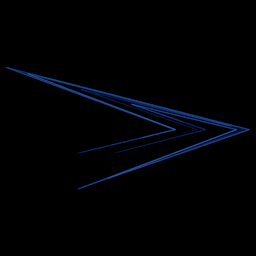

# Lozi

`lozi` · map · 2-D · family: Maps



The piecewise-linear cousin of Hénon — a strange attractor built from straight segments.

## Equations

```text
x′ = 1 − a · abs(x) + y
y′ = b · x
```

## Parameters

| Name | Default | Range | Meaning |
|---|---|---|---|
| a | 1.7 | [1.2, 1.9] |  |
| b | 0.5 | [0.1, 0.6] |  |

## References

- R. Lozi, J. Phys. Colloques 39 (1978)

## Source (`.atr`)

```text
name: Lozi
family: Maps
desc: The piecewise-linear cousin of Hénon — a strange attractor built from straight segments.
ref: R. Lozi, J. Phys. Colloques 39 (1978)
tags: map, 2d
dims: 2
ic: 0.1 0.1 0
warmup: 200

param a = 1.7 [1.2, 1.9]
param b = 0.5 [0.1, 0.6]

x' = 1 - a*abs(x) + y
y' = b*x
```

Render it: `attractr render lozi --size 2048x2048 --report md`
