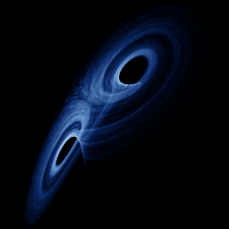

# Lü

`lu` · flow · 3-D · family: Flows



The Lü–Chen system — bridges the Lorenz and Chen attractors.

## Equations

```text
dx/dt = a · (y − x)
dy/dt = −x · z + c · y
dz/dt = x · y − b · z
```

## Parameters

| Name | Default | Range | Meaning |
|---|---|---|---|
| a | 36 | [20, 45] | Coupling a(y − x). |
| b | 3 | [1, 6] | Damping of z. |
| c | 20 | [10, 30] | Growth of y. |

Integration: RK4, default dt = 0.005, initial condition (0.1, 0.1, 0.1).

## References

- J. Lü & G. Chen, Int. J. Bifurcation Chaos 12 (2002)

## Source (`.atr`)

```text
name: Lü
family: Flows
desc: The Lü–Chen system — bridges the Lorenz and Chen attractors.
ref: J. Lü & G. Chen, Int. J. Bifurcation Chaos 12 (2002)
tags: flow, 3d
dt: 0.005
ic: 0.1 0.1 0.1
camera: 25 20 0 1

param a = 36 [20, 45] "Coupling a(y − x)."
param b = 3 [1, 6] "Damping of z."
param c = 20 [10, 30] "Growth of y."

dx = a*(y - x)
dy = -x*z + c*y
dz = x*y - b*z
```

Render it: `attractr render lu --size 2048x2048 --report md`
