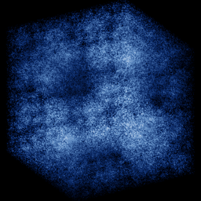

# Menger dust

`menger_dust` · ifs · 3-D · family: IFS



Chaos game on the 20 sub-cubes of the Menger sponge — a 3-D fractal dust to rotate.

## Equations

```text
with p = 1:
    x′ = s · x − 1
    y′ = s · y − 1
    z′ = s · z − 1
with p = 1:
    x′ = s · x
    y′ = s · y − 1
    z′ = s · z − 1
with p = 1:
    x′ = s · x + 1
    y′ = s · y − 1
    z′ = s · z − 1
with p = 1:
    x′ = s · x − 1
    y′ = s · y
    z′ = s · z − 1
with p = 1:
    x′ = s · x + 1
    y′ = s · y
    z′ = s · z − 1
with p = 1:
    x′ = s · x − 1
    y′ = s · y + 1
    z′ = s · z − 1
with p = 1:
    x′ = s · x
    y′ = s · y + 1
    z′ = s · z − 1
with p = 1:
    x′ = s · x + 1
    y′ = s · y + 1
    z′ = s · z − 1
with p = 1:
    x′ = s · x − 1
    y′ = s · y − 1
    z′ = s · z
with p = 1:
    x′ = s · x + 1
    y′ = s · y − 1
    z′ = s · z
with p = 1:
    x′ = s · x − 1
    y′ = s · y + 1
    z′ = s · z
with p = 1:
    x′ = s · x + 1
    y′ = s · y + 1
    z′ = s · z
with p = 1:
    x′ = s · x − 1
    y′ = s · y − 1
    z′ = s · z + 1
with p = 1:
    x′ = s · x
    y′ = s · y − 1
    z′ = s · z + 1
with p = 1:
    x′ = s · x + 1
    y′ = s · y − 1
    z′ = s · z + 1
with p = 1:
    x′ = s · x − 1
    y′ = s · y
    z′ = s · z + 1
with p = 1:
    x′ = s · x + 1
    y′ = s · y
    z′ = s · z + 1
with p = 1:
    x′ = s · x − 1
    y′ = s · y + 1
    z′ = s · z + 1
with p = 1:
    x′ = s · x
    y′ = s · y + 1
    z′ = s · z + 1
with p = 1:
    x′ = s · x + 1
    y′ = s · y + 1
    z′ = s · z + 1
```

## Parameters

| Name | Default | Range | Meaning |
|---|---|---|---|
| s | 0.3333 | [0.2, 0.45] | Contraction (1/3 is the true sponge). |

## Source (`.atr`)

```text
name: Menger dust
family: IFS
desc: Chaos game on the 20 sub-cubes of the Menger sponge — a 3-D fractal dust to rotate.
tags: ifs, 3d
warmup: 20
ic: 0 0 0
camera: 30 25 0 1

param s = 0.3333 [0.2, 0.45] "Contraction (1/3 is the true sponge)."

choose {
  1: x' = s*x - 1; y' = s*y - 1; z' = s*z - 1
  1: x' = s*x;     y' = s*y - 1; z' = s*z - 1
  1: x' = s*x + 1; y' = s*y - 1; z' = s*z - 1
  1: x' = s*x - 1; y' = s*y;     z' = s*z - 1
  1: x' = s*x + 1; y' = s*y;     z' = s*z - 1
  1: x' = s*x - 1; y' = s*y + 1; z' = s*z - 1
  1: x' = s*x;     y' = s*y + 1; z' = s*z - 1
  1: x' = s*x + 1; y' = s*y + 1; z' = s*z - 1
  1: x' = s*x - 1; y' = s*y - 1; z' = s*z
  1: x' = s*x + 1; y' = s*y - 1; z' = s*z
  1: x' = s*x - 1; y' = s*y + 1; z' = s*z
  1: x' = s*x + 1; y' = s*y + 1; z' = s*z
  1: x' = s*x - 1; y' = s*y - 1; z' = s*z + 1
  1: x' = s*x;     y' = s*y - 1; z' = s*z + 1
  1: x' = s*x + 1; y' = s*y - 1; z' = s*z + 1
  1: x' = s*x - 1; y' = s*y;     z' = s*z + 1
  1: x' = s*x + 1; y' = s*y;     z' = s*z + 1
  1: x' = s*x - 1; y' = s*y + 1; z' = s*z + 1
  1: x' = s*x;     y' = s*y + 1; z' = s*z + 1
  1: x' = s*x + 1; y' = s*y + 1; z' = s*z + 1
}
```

Render it: `attractr render menger_dust --size 2048x2048 --report md`
