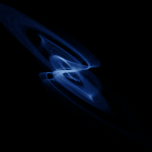

# Moore-Spiegel

`moore_spiegel` · flow · 3-D · family: Flows



A stellar-oscillation model (Moore & Spiegel 1966) — a twisted, single-lobed attractor.

## Equations

```text
dx/dt = y
dy/dt = z
dz/dt = −z − (T − R + R · x²) · y − T · x
```

## Parameters

| Name | Default | Range | Meaning |
|---|---|---|---|
| T | 6 | [3, 10] |  |
| R | 20 | [10, 40] |  |

Integration: RK4, default dt = 0.01, initial condition (0.1, 0.1, 0.1).

## References

- D. W. Moore & E. A. Spiegel, Astrophys. J. 143 (1966)

## Source (`.atr`)

```text
name: Moore-Spiegel
family: Flows
desc: A stellar-oscillation model (Moore & Spiegel 1966) — a twisted, single-lobed attractor.
ref: D. W. Moore & E. A. Spiegel, Astrophys. J. 143 (1966)
tags: flow, 3d
dt: 0.01
ic: 0.1 0.1 0.1
camera: 25 20 0 1

param T = 6 [3, 10]
param R = 20 [10, 40]

dx = y
dy = z
dz = -z - (T - R + R*x^2)*y - T*x
```

Render it: `attractr render moore_spiegel --size 2048x2048 --report md`
