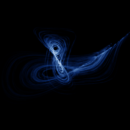

# Newton-Leipnik

`newton_leipnik` · flow · 3-D · family: Flows



Rigid-body motion with linear feedback — two interlaced strange attractors.

## Equations

```text
dx/dt = −α · x + y + 10 · y · z
dy/dt = −x − 0.4 · y + 5 · x · z
dz/dt = β · z − 5 · x · y
```

## Parameters

| Name | Default | Range | Meaning |
|---|---|---|---|
| alpha | 0.4 | [0.2, 0.6] | α |
| beta | 0.175 | [0.1, 0.25] | β |

Integration: RK4, default dt = 0.01, initial condition (0.349, 0.0, -0.16, 0.0).

## References

- R. B. Leipnik & T. A. Newton, Phys. Lett. A 86 (1981)

## Source (`.atr`)

```text
name: Newton-Leipnik
family: Flows
desc: Rigid-body motion with linear feedback — two interlaced strange attractors.
ref: R. B. Leipnik & T. A. Newton, Phys. Lett. A 86 (1981)
tags: flow, 3d
dt: 0.01
ic: 0.349 0 -0.16
camera: 25 20 0 1

param alpha = 0.4 [0.2, 0.6] "α"
param beta = 0.175 [0.1, 0.25] "β"

dx = -alpha*x + y + 10*y*z
dy = -x - 0.4*y + 5*x*z
dz = beta*z - 5*x*y
```

Render it: `attractr render newton_leipnik --size 2048x2048 --report md`
