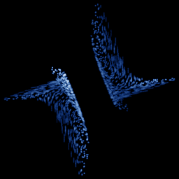

# Polynomial A

`polynomial_a` · map · 3-D · family: Maps



Chaoscope's "Polynomial A" — a three-parameter quadratic 3-D map with a rotational structure.

## Equations

```text
x′ = a0 + y − y · z
y′ = a1 + z − x · z
z′ = a2 + x − x · y
```

## Parameters

| Name | Default | Range | Meaning |
|---|---|---|---|
| a0 | 1 | [-2, 2] |  |
| a1 | 1 | [-2, 2] |  |
| a2 | 1 | [-2, 2] |  |

## Source (`.atr`)

```text
name: Polynomial A
family: Maps
desc: Chaoscope's "Polynomial A" — a three-parameter quadratic 3-D map with a rotational structure.
tags: map, 3d, polynomial, chaoscope
ic: 0.1 0.1 0.1
warmup: 200
camera: 25 20 0 1

param a0 = 1.0 [-2, 2]
param a1 = 1.0 [-2, 2]
param a2 = 1.0 [-2, 2]

x' = a0 + y - y*z
y' = a1 + z - x*z
z' = a2 + x - x*y
```

Render it: `attractr render polynomial_a --size 2048x2048 --report md`
