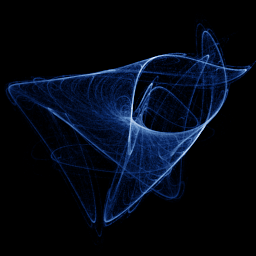

# Polynomial Sprott (quadratic 3-D)

`polynomial_sprott` · map · 3-D · family: Maps



J. C. Sprott's general quadratic 3-D map: each coordinate is a full quadratic polynomial (30 coefficients). Most random coefficient sets diverge or collapse — use Search to find chaotic ones, as the classic Chaoscope did.

## Equations

```text
x′ = x0 + x1 · x + x2 · y + x3 · z + x4 · x · x + x5 · y · y + x6 · z · z + x7 · x · y + x8 · x · z + x9 · y · z
y′ = y0 + y1 · x + y2 · y + y3 · z + y4 · x · x + y5 · y · y + y6 · z · z + y7 · x · y + y8 · x · z + y9 · y · z
z′ = z0 + z1 · x + z2 · y + z3 · z + z4 · x · x + z5 · y · y + z6 · z · z + z7 · x · y + z8 · x · z + z9 · y · z
```

## Parameters

| Name | Default | Range | Meaning |
|---|---|---|---|
| x0 | 0.576 | [-1.2, 1.2] |  |
| x1 | -0.189 | [-1.2, 1.2] |  |
| x2 | -1.138 | [-1.2, 1.2] |  |
| x3 | -0.199 | [-1.2, 1.2] |  |
| x4 | -0.552 | [-1.2, 1.2] |  |
| x5 | 0.002 | [-1.2, 1.2] |  |
| x6 | -1.134 | [-1.2, 1.2] |  |
| x7 | -0.347 | [-1.2, 1.2] |  |
| x8 | -0.599 | [-1.2, 1.2] |  |
| x9 | -0.326 | [-1.2, 1.2] |  |
| y0 | 0.221 | [-1.2, 1.2] |  |
| y1 | -1.098 | [-1.2, 1.2] |  |
| y2 | -0.107 | [-1.2, 1.2] |  |
| y3 | 0.578 | [-1.2, 1.2] |  |
| y4 | -0.541 | [-1.2, 1.2] |  |
| y5 | 0.509 | [-1.2, 1.2] |  |
| y6 | 1.139 | [-1.2, 1.2] |  |
| y7 | 0.429 | [-1.2, 1.2] |  |
| y8 | -0.866 | [-1.2, 1.2] |  |
| y9 | 0.594 | [-1.2, 1.2] |  |
| z0 | -0.964 | [-1.2, 1.2] |  |
| z1 | -0.791 | [-1.2, 1.2] |  |
| z2 | 0.695 | [-1.2, 1.2] |  |
| z3 | -0.159 | [-1.2, 1.2] |  |
| z4 | 0.5 | [-1.2, 1.2] |  |
| z5 | 0.588 | [-1.2, 1.2] |  |
| z6 | -0.16 | [-1.2, 1.2] |  |
| z7 | -0.157 | [-1.2, 1.2] |  |
| z8 | -0.965 | [-1.2, 1.2] |  |
| z9 | -0.507 | [-1.2, 1.2] |  |

## References

- J. C. Sprott, "Strange Attractors: Creating Patterns in Chaos" (1993)

## Source (`.atr`)

```text
name: Polynomial Sprott (quadratic 3-D)
family: Maps
desc: J. C. Sprott's general quadratic 3-D map: each coordinate is a full quadratic polynomial (30 coefficients). Most random coefficient sets diverge or collapse — use Search to find chaotic ones, as the classic Chaoscope did.
ref: J. C. Sprott, "Strange Attractors: Creating Patterns in Chaos" (1993)
tags: map, 3d, polynomial, chaoscope, search
ic: 0.05 0.05 0.05
jitter: 0.02
warmup: 300
camera: 25 20 0 1

param x0 = 0.576 [-1.2, 1.2]
param x1 = -0.189 [-1.2, 1.2]
param x2 = -1.138 [-1.2, 1.2]
param x3 = -0.199 [-1.2, 1.2]
param x4 = -0.552 [-1.2, 1.2]
param x5 = 0.002 [-1.2, 1.2]
param x6 = -1.134 [-1.2, 1.2]
param x7 = -0.347 [-1.2, 1.2]
param x8 = -0.599 [-1.2, 1.2]
param x9 = -0.326 [-1.2, 1.2]
param y0 = 0.221 [-1.2, 1.2]
param y1 = -1.098 [-1.2, 1.2]
param y2 = -0.107 [-1.2, 1.2]
param y3 = 0.578 [-1.2, 1.2]
param y4 = -0.541 [-1.2, 1.2]
param y5 = 0.509 [-1.2, 1.2]
param y6 = 1.139 [-1.2, 1.2]
param y7 = 0.429 [-1.2, 1.2]
param y8 = -0.866 [-1.2, 1.2]
param y9 = 0.594 [-1.2, 1.2]
param z0 = -0.964 [-1.2, 1.2]
param z1 = -0.791 [-1.2, 1.2]
param z2 = 0.695 [-1.2, 1.2]
param z3 = -0.159 [-1.2, 1.2]
param z4 = 0.5 [-1.2, 1.2]
param z5 = 0.588 [-1.2, 1.2]
param z6 = -0.16 [-1.2, 1.2]
param z7 = -0.157 [-1.2, 1.2]
param z8 = -0.965 [-1.2, 1.2]
param z9 = -0.507 [-1.2, 1.2]

x' = x0 + x1*x + x2*y + x3*z + x4*x*x + x5*y*y + x6*z*z + x7*x*y + x8*x*z + x9*y*z
y' = y0 + y1*x + y2*y + y3*z + y4*x*x + y5*y*y + y6*z*z + y7*x*y + y8*x*z + y9*y*z
z' = z0 + z1*x + z2*y + z3*z + z4*x*x + z5*y*y + z6*z*z + z7*x*y + z8*x*z + z9*y*z
```

Render it: `attractr render polynomial_sprott --size 2048x2048 --report md`
